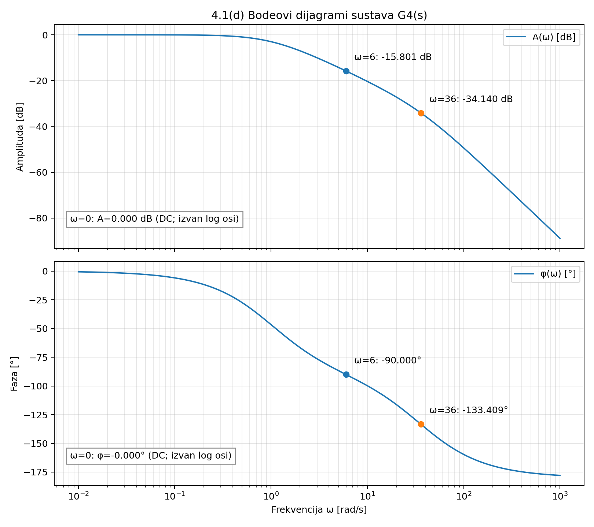
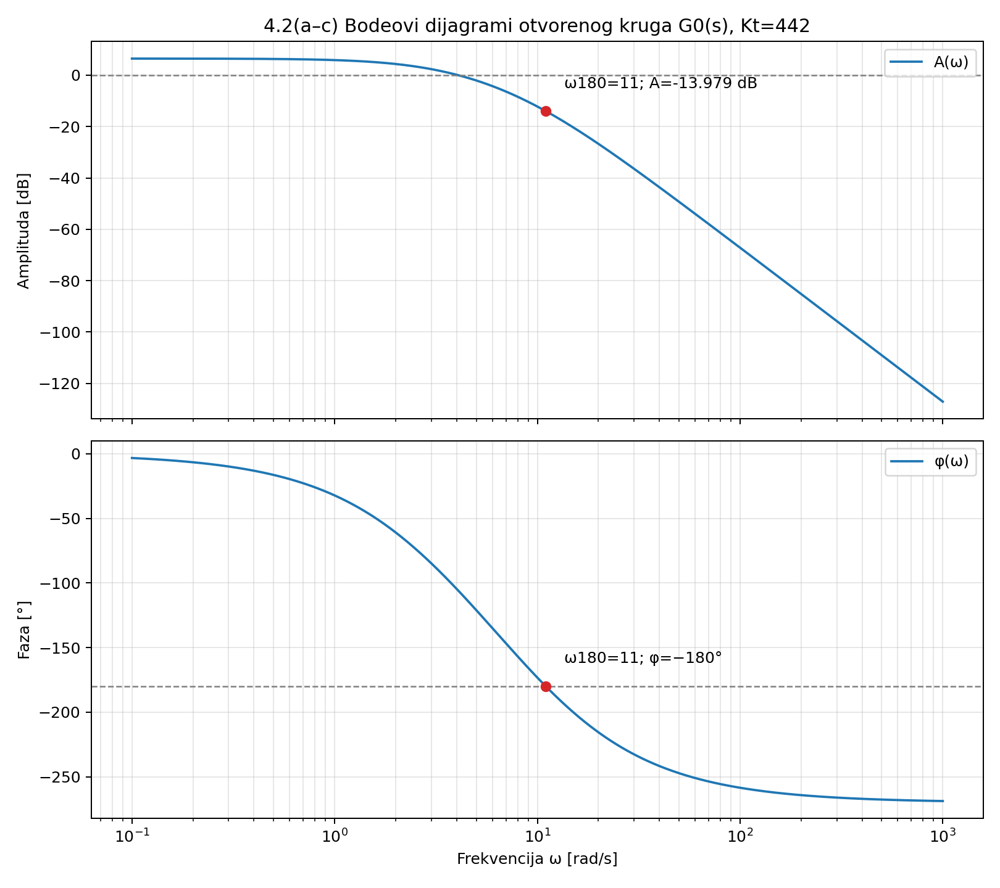

# Internet stvari – Prvi programski zadatak

# Zadatak 4 – Frekvencijska analiza sustava

**Grupa 10**

## 4.1 Frekvencijske karakteristike

Zadano: G4(s) = 36 / [(s + 1)(s + 36)]. Parametri su K4 = 36, a = 1, b = 36.

## 4.1(a) Kompleksna frekvencijska funkcija

Zamjenom s = jω: G4(jω) = 36 / [(1 + jω)(36 + jω)] = 36 / [(36 − ω²) + j37ω].  
Racionalizacija množenjem konjugiranim nazivnikom daje:  
G4(jω) = 36[(36 − ω²) − j37ω] / [(36 − ω²)² + (37ω)²].  
Re{G4(jω)} = 36(36 − ω²) / [(36 − ω²)² + (37ω)²].  
Im{G4(jω)} = −1332ω / [(36 − ω²)² + (37ω)²].

## 4.1(b) Amplituda, pojačanje i faza

|G4(jω)| = 36 / sqrt[(1 + ω²)(1296 + ω²)].  
A(ω) = 20 log10[36 / sqrt((1 + ω²)(1296 + ω²))] dB.  
φ(ω) = −arctan(ω/1) − arctan(ω/36), pri čemu su kutovi u stupnjevima.

## 4.1(c) Tri zadane frekvencije

ω = 0 rad/s: |G4| = 1,000; A = 0,000 dB; φ = 0,000°.  
ω = sqrt(ab) = 6 rad/s: |G4| = 0,162; A = −15,801 dB; φ = −90,000°.  
ω = b = 36 rad/s: |G4| = 0,020; A = −34,140 dB; φ = −133,409°.  
Za ω = sqrt(ab) = 6 nazivnik je (36 − 36) + j(37 · 6) = j222. Stoga je G4(j6) = 36/(j222) = −j(6/37), pa je faza točno −90°.

## 4.1(d) Bodeovi dijagrami

Amplitudno-frekvencijska i fazno-frekvencijska karakteristika nacrtane su funkcijom scipy.signal.bode. Označene su točke za ω = 6 i ω = 36. Vrijednosti pri ω = 0 prikazane su tekstom jer se nula ne može prikazati na logaritamskoj frekvencijskoj osi.

## 4.2 Povezivanje s Hurwitzovim postupkom

Otvoreni krug iz zadatka 3.2 uz K = Kt = 442:  
G0(s) = 442 / [(s + 3)(s + 7)(s + 10)] = 442/(s³ + 20s² + 121s + 210).

## 4.2(a) Bodeovi dijagrami

Frekvencijske karakteristike otvorenog kruga dobivene su u Pythonu funkcijom scipy.signal.bode i prikazane na drugom grafu.

## 4.2(b) Frekvencija faze −180° i pričuva pojačanja

Uvrštavanjem s = jω nazivnik je (210 − 20ω²) + j(121ω − ω³).  
Za fazu −180° imaginarni dio je nula, a realni negativan: ω(121 − ω²) = 0, pa je ω180 = sqrt(121) = 11,000 rad/s.  
Pri ω = 11 nazivnik je −2210, pa G0(j11) = −442/2210 = −0,200.  
|G0(j11)| = 0,200; A(ω180) = 20 log10(0,200) = −13,979 dB.  
Pričuva pojačanja GM = −A(ω180) = 13,979 dB.

## 4.2(c) Usporedba s Hurwitzovim postupkom

Iz zadatka 3.2 dobiveno je Kkr = 2210 i ωkr = 11 rad/s. Dakle ω180 = ωkr = 11,000 rad/s.  
GM = 20 log10(Kkr/Kt) = 20 log10(2210/442) = 20 log10(5) = 13,979 dB.  
Frekvencijska analiza i Hurwitzov postupak daju isti kritični uvjet.

## Zaključak

Za G4(s) faza na geometrijskoj sredini prijelomnih frekvencija, ω = 6 rad/s, iznosi točno −90°. Za otvoreni krug G0(s) pri Kt = 442, faza −180° postiže se na ω = 11 rad/s, a pričuva pojačanja je 13,979 dB. To potvrđuje kritično pojačanje Kkr = 2210 iz zadatka 3.2.

## Grafovi

### 4.1(d) Bodeovi dijagrami



### 4.2 Bodeovi dijagrami otvorenog kruga



## Python kod

Datoteka: [`frekvencijska_analiza.py`](frekvencijska_analiza.py). Za pokretanje: `python frekvencijska_analiza.py`.

```python
"""Internet stvari – 1. programski zadatak, grupa 10, zadatak 4.
Pokretanje: python frekvencijska_analiza.py
Ovisnosti: numpy, scipy, matplotlib
"""
from pathlib import Path
import numpy as np
import matplotlib.pyplot as plt
from scipy import signal

MAPA = Path(__file__).resolve().parent

# 4.1: G4(s) = 36/((s+1)(s+36)) = 36/(s^2+37s+36)
K4, a, b = 36.0, 1.0, 36.0
sustav_4 = signal.TransferFunction([K4], [1, a+b, a*b])

# Analiticki izraz: nazivnik G4(jw) = (ab-w^2)+j*w*(a+b).
# Mnozenjem s kompleksno konjugiranim nazivnikom dobiju se Re i Im.
def karakteristike(w):
    x = a*b-w*w
    y = (a+b)*w
    nazivnik_kvadrat = x*x+y*y
    re = K4*x/nazivnik_kvadrat
    im = -K4*y/nazivnik_kvadrat
    amplituda = np.hypot(re, im)
    db = 20*np.log10(amplituda)
    faza = np.degrees(np.arctan2(im, re))
    return re, im, amplituda, db, faza

print('4.1(a–c) Vrijednosti za trazene frekvencije:')
print('omega [rad/s] | Re | Im | |G4| | A [dB] | faza [stupnjevi]')
frekvencije = [0.0, np.sqrt(a*b), b]
for w in frekvencije:
    re, im, amp, db, faza = karakteristike(w)
    print(f'{w:12.3f} | {re:8.3f} | {im:8.3f} | {amp:8.3f} | {db:8.3f} | {faza:8.3f}')

# 4.1(d): scipy.signal.bode ne prihvaca omega=0 na logaritamskoj osi.
# Nultu frekvenciju zato oznacavamo tekstom kao DC vrijednost,
# dok su omega=6 i omega=36 prikazane oznacenim tockama.
w = np.logspace(-2, 3, 1800)
w, mag, phase = signal.bode(sustav_4, w=w)
fig, (ax1, ax2) = plt.subplots(2, 1, figsize=(9, 8), sharex=True)
ax1.semilogx(w, mag, label='A(ω) [dB]')
ax2.semilogx(w, phase, label='φ(ω) [°]')
for f in [6.0, 36.0]:
    _, _, _, db, faza = karakteristike(f)
    ax1.scatter([f], [db], zorder=5)
    ax2.scatter([f], [faza], zorder=5)
    ax1.annotate(f'ω={f:g}: {db:.3f} dB', (f, db), xytext=(9, 12), textcoords='offset points')
    ax2.annotate(f'ω={f:g}: {faza:.3f}°', (f, faza), xytext=(9, 12), textcoords='offset points')
_, _, _, db0, faza0 = karakteristike(0)
ax1.text(0.03, 0.12, f'ω=0: A={db0:.3f} dB (DC; izvan log osi)', transform=ax1.transAxes,
         bbox={'facecolor':'white','alpha':0.9,'edgecolor':'gray'})
ax2.text(0.03, 0.12, f'ω=0: φ={faza0:.3f}° (DC; izvan log osi)', transform=ax2.transAxes,
         bbox={'facecolor':'white','alpha':0.9,'edgecolor':'gray'})
ax1.set(ylabel='Amplituda [dB]', title='4.1(d) Bodeovi dijagrami sustava G4(s)')
ax2.set(xlabel='Frekvencija ω [rad/s]', ylabel='Faza [°]')
for ax in (ax1, ax2):
    ax.grid(True, which='both', alpha=0.3)
    ax.legend(loc='upper right')
fig.tight_layout()
fig.savefig(MAPA/'4_1_bode.png', dpi=180)
plt.close(fig)

# 4.2: Otvoreni krug iz 3.2, uz Kt=442.
Kt, Kkr = 442.0, 2210.0
sustav_0 = signal.TransferFunction([Kt], np.poly([-3., -7., -10.]))
w180 = np.sqrt(3*7+3*10+7*10)  # sqrt(121) = 11 rad/s
GM = 20*np.log10(Kkr/Kt)
w, mag, phase = signal.bode(sustav_0, w=np.logspace(-1, 3, 2000))
_, mag180, phase180 = signal.bode(sustav_0, w=np.array([w180]))
print(f'4.2(b–c) ω180 = {w180:.3f} rad/s')
print(f'4.2(b–c) A(ω180) = {mag180[0]:.3f} dB; faza = {phase180[0]:.3f}°')
print(f'4.2(b–c) GM = {GM:.3f} dB = 20 log10({Kkr:g}/{Kt:g})')
fig, (ax1, ax2) = plt.subplots(2, 1, figsize=(9, 8), sharex=True)
ax1.semilogx(w, mag, label='A(ω)')
ax2.semilogx(w, phase, label='φ(ω)')
ax1.scatter([w180], [mag180[0]], color='tab:red', zorder=5)
ax2.scatter([w180], [phase180[0]], color='tab:red', zorder=5)
ax1.annotate(f'ω180=11; A={mag180[0]:.3f} dB', (w180, mag180[0]),
             xytext=(12, 15), textcoords='offset points')
ax2.annotate('ω180=11; φ=−180°', (w180, phase180[0]),
             xytext=(12, 15), textcoords='offset points')
ax1.axhline(0, linestyle='--', color='gray', linewidth=1)
ax2.axhline(-180, linestyle='--', color='gray', linewidth=1)
ax1.set(ylabel='Amplituda [dB]', title='4.2(a–c) Bodeovi dijagrami otvorenog kruga G0(s), Kt=442')
ax2.set(xlabel='Frekvencija ω [rad/s]', ylabel='Faza [°]')
for ax in (ax1, ax2):
    ax.grid(True, which='both', alpha=0.3)
    ax.legend(loc='upper right')
fig.tight_layout()
fig.savefig(MAPA/'4_2_bode.png', dpi=180)
plt.close(fig)
print('Grafovi spremljeni u:', MAPA)

```