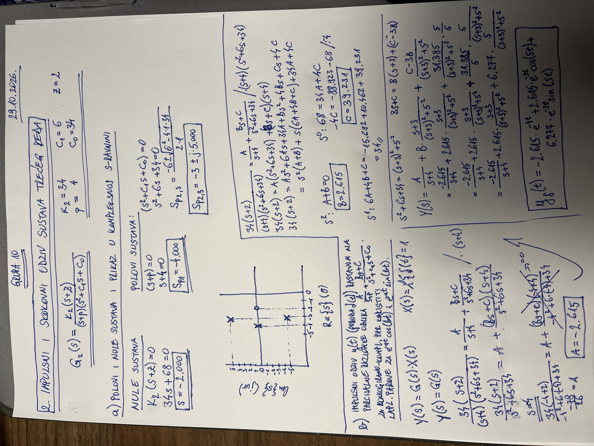
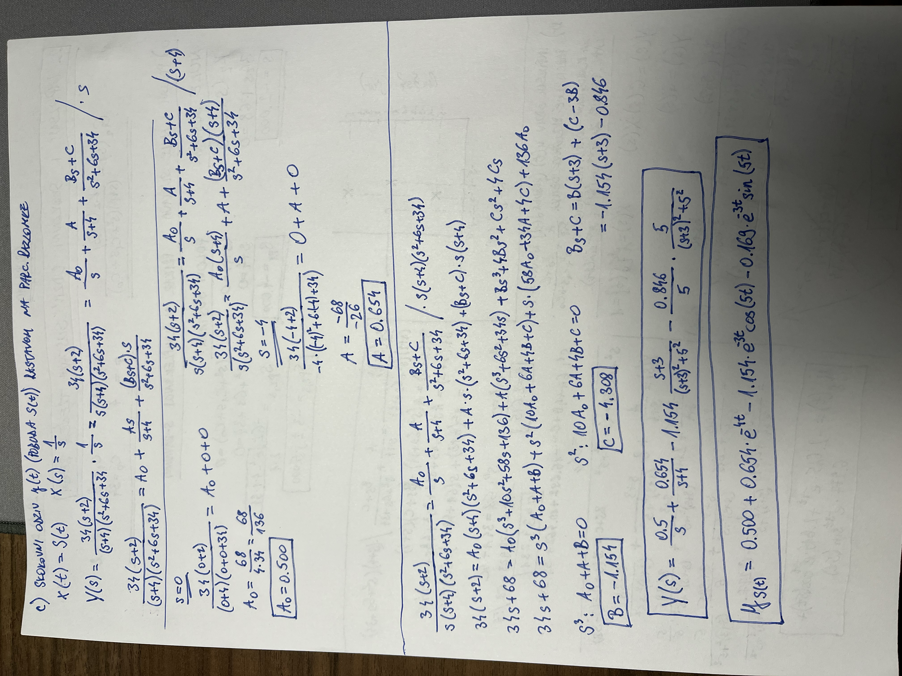
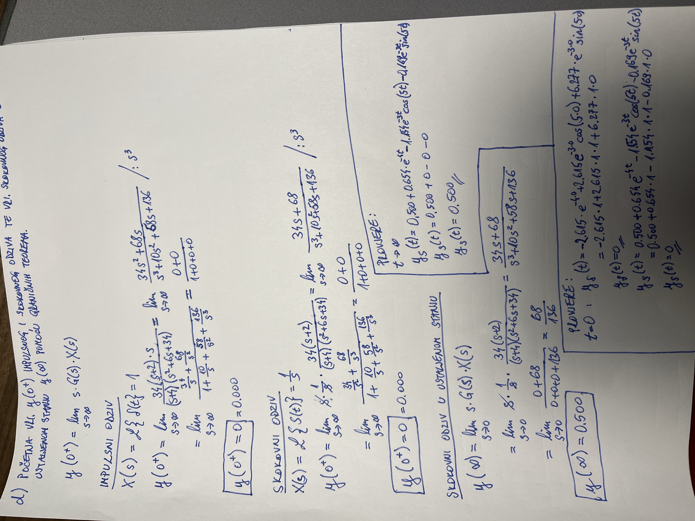
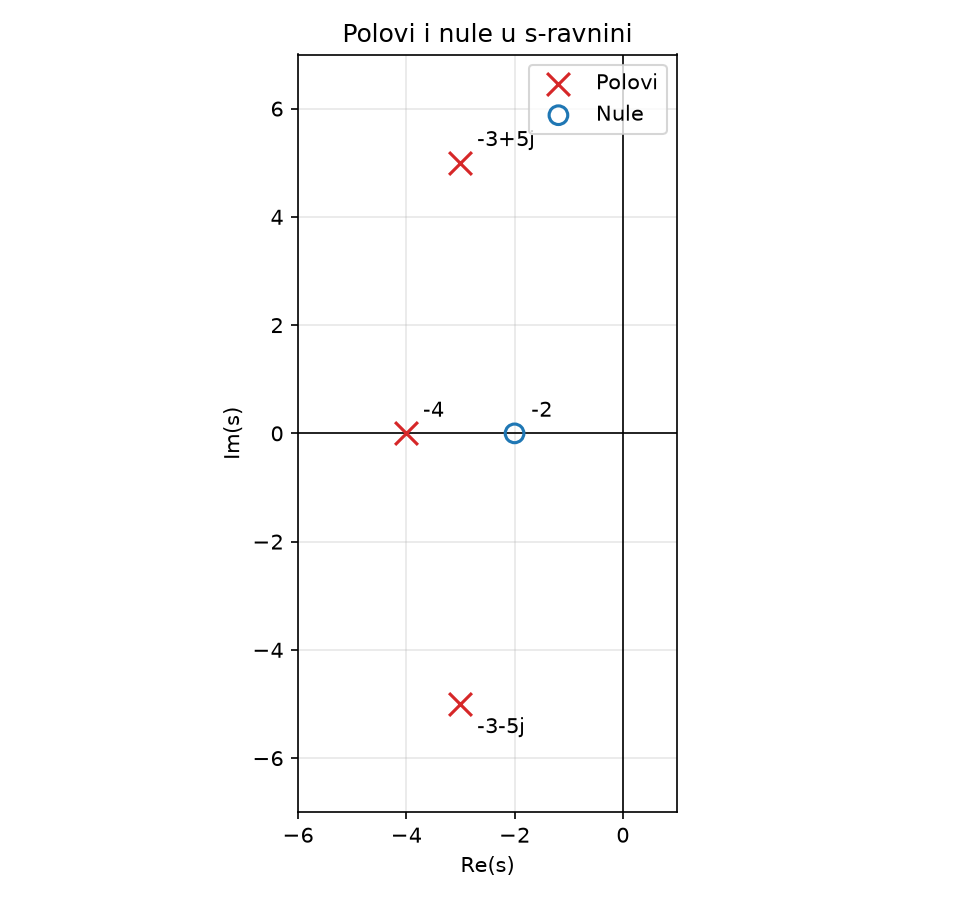
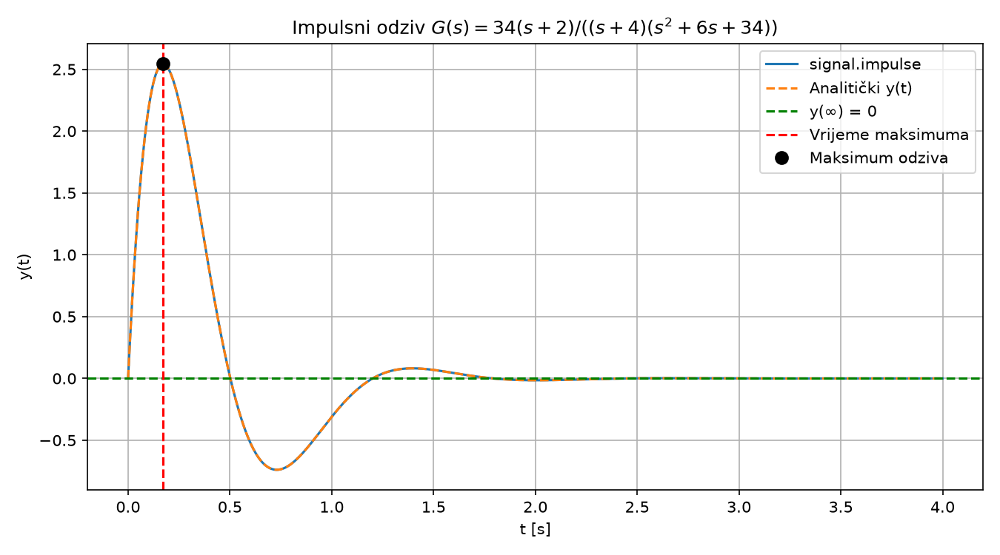
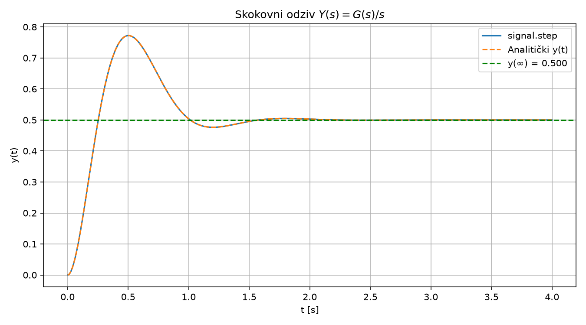

# Impulsni odziv

## Zadaci a i b

## Zadatak c

## Zadatak d

## Zadatak e

Zadatak e je napravljen unutar ove mape.

Polovi i nule, impulsni te skokovni odziv izrađeni su pomoću Python koda.

Polovi i nule sustava u s-ravnini (zadatak a):

Impulsni odziv — `signal.impulse` i analitički izraz iz zadatka b:

Skokovni odziv — `signal.step` i analitički izraz iz zadatka c:

## Osvrt na izračun

Analitički izrazi izvedeni rastavom na parcijalne razlomke uspoređeni su s
rezultatima simulacije (`signal.impulse` i `signal.step`). Krivulje se u
potpunosti preklapaju; najveća razlika između analitičkog i simuliranog odziva
je reda veličine 10⁻¹⁴, što odgovara numeričkoj preciznosti računala. Time je
potvrđena ispravnost izračuna iz točaka b i c.

Teoremi o početnoj i konačnoj vrijednosti potvrđeni su uvrštavanjem u analitičke
izraze i očitanjem iz simulacije:

| veličina   | teorem | analitički | simulirano |
| ---------- | ------ | ---------- | ---------- |
| y_imp(0⁺)  | 0.000  | 0.000      | 0.000      |
| y_step(0⁺) | 0.000  | 0.000      | 0.000      |
| y_step(∞)  | 0.500  | 0.500      | 0.500      |

Impulsni odziv počinje od nule jer je razlika reda nazivnika i brojnika
n − m = 2. Skokovni odziv ustaljuje se na y(∞) = G₂(0) = 68/136 = 0.500, pa je i
greška u ustaljenom stanju jednoznačno određena.
