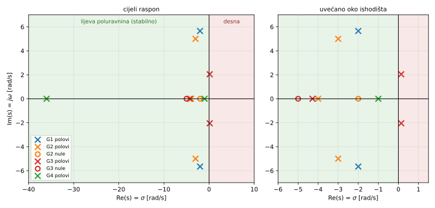
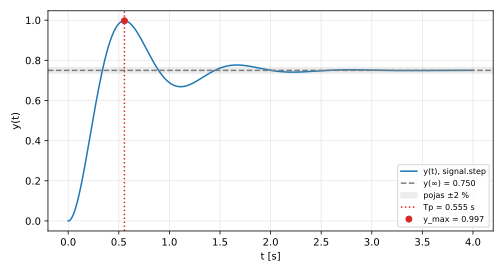
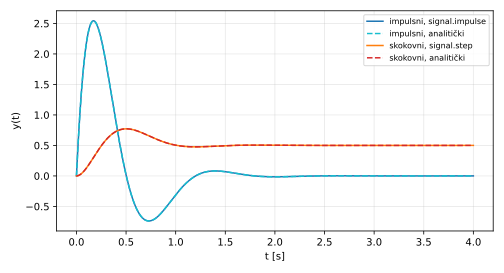
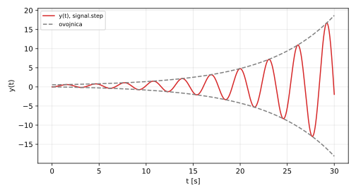
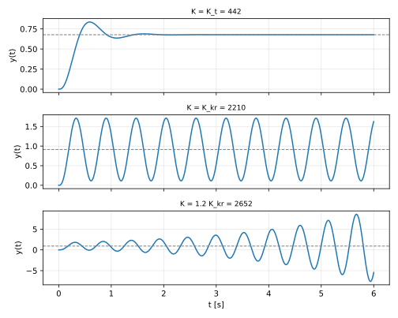
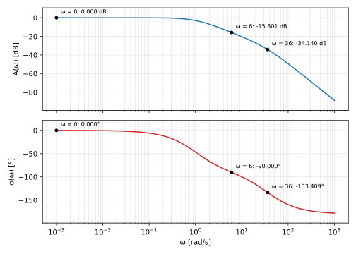
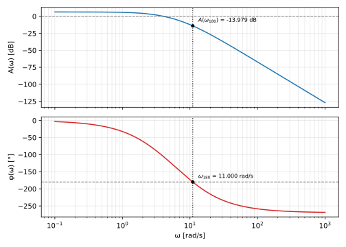

# Zadani sustavi

Grupa 10 uzima sljedeće vrijednosti iz tablica A i B. Vrijednosti su zaokružene na tri decimale; vrijeme je u sekundama, frekvencija u rad/s, a kut u stupnjevima. Grafički dio izrađen je u Pythonu (`scipy.signal`, `numpy`, `matplotlib.pyplot`), a kod i ispis rezultata nalaze se u prilozima.

$$G_1(s) = \frac{27}{s^2 + 4s + 36}, \qquad G_2(s) = \frac{34(s + 2)}{(s + 4)(s^2 + 6s + 34)}$$

$$G_3(s) = \frac{s + 5}{s^3 + 4s^2 + 3s + 18}, \qquad G_4(s) = \frac{36}{(s + 1)(s + 36)}$$

$$G_0(s) = \frac{K}{(s + 3)(s + 7)(s + 10)}, \qquad K_t = 442$$

Polovi i nule svih sustava prikazani su u kompleksnoj $s$-ravnini na slici ispod. Pol sustava $G_4$ u $s = -36$ daleko je od ostalih, pa je uz cijeli raspon prikazano i uvećano područje oko ishodišta.

# Zadatak 1: Skokovni odziv sustava drugog reda

$$G_1(s) = \frac{K_1}{s^2 + a_1 s + a_0}, \qquad K_1 = 27,\quad a_1 = 4,\quad a_0 = 36$$

## a) Polovi sustava

Rješavamo $s^2 + 4s + 36 = 0$ kvadratnom formulom:

$$s_{1,2} = \frac{-4 \pm \sqrt{16 - 144}}{2} = \frac{-4 \pm \sqrt{-128}}{2} = -2 \pm j\sqrt{32} = -2 \pm j\,5.657$$

Oba pola leže u lijevoj poluravnini izvan realne osi, pa je sustav stabilan i podkritično prigušen. Položaj polova prikazan je na Slici 1.

## b) Frekvencija vlastitih oscilacija i faktor prigušenja

Usporedbom s $\dfrac{\omega_n^2}{s^2 + 2\zeta\omega_n s + \omega_n^2}$:

$$\omega_n^2 = 36 \Rightarrow \omega_n = 6.000\ \text{rad/s}$$

$$2\zeta\omega_n = 4 \Rightarrow \zeta = \frac{4}{2 \cdot 6} = \frac{1}{3} = 0.333$$

Konstanta $K_1 = 27$ razlikuje se od $\omega_n^2 = 36$, pa statičko pojačanje nije jedinično. Ona određuje $y(\infty)$, što računamo u točki e).

## c) Parametri skokovnog odziva

**Frekvencija prigušenih oscilacija:**

$$\omega_d = \omega_n\sqrt{1-\zeta^2} = 6\sqrt{1 - \frac{1}{9}} = \sqrt{32} = 5.657\ \text{rad/s}$$

**Vrijeme prvog maksimuma:**

$$T_p = \frac{\pi}{\omega_d} = \frac{3.142}{5.657} = 0.555\ \text{s}$$

**Postotak nadvišenja prvog maksimuma:**

$$\frac{\zeta\pi}{\sqrt{1-\zeta^2}} = \frac{\pi}{2\sqrt{2}} = 1.111$$

$$P.O. = 100\,e^{-\pi/(2\sqrt{2})} = 32.932\,\%$$

**Vrijeme smirivanja (ulazak u pojas ±2 % oko konačne vrijednosti):**

$$T_s = \frac{4}{\zeta\omega_n} = \frac{4}{2} = 2.000\ \text{s}$$

## d) Analitički izraz skokovnog odziva

**Slika skokovne pobude** s $X(s) = \dfrac{1}{s}$:

$$Y(s) = \frac{27}{s\,(s^2 + 4s + 36)}$$

**Rastav na parcijalne razlomke:**

$$\frac{27}{s(s^2+4s+36)} = \frac{A}{s} + \frac{Bs + C}{s^2 + 4s + 36}$$

Množimo cijelu jednadžbu s $s(s^2+4s+36)$:

$$27 = A(s^2 + 4s + 36) + (Bs + C)\,s$$

Izjednačavanjem koeficijenata:

- $s^0$: $27 = 36A \Rightarrow A = \dfrac{27}{36} = 0.750$
- $s^2$: $0 = A + B \Rightarrow B = -0.750$
- $s^1$: $0 = 4A + C \Rightarrow C = -3.000$

$$Y(s) = \frac{0.750}{s} - \frac{0.750\,s + 3}{s^2 + 4s + 36}$$

**Prilagodba za Laplaceove parove.** Nazivnik zapisujemo kao $(s+2)^2 + 32$:

$$0.750\,s + 3 = 0.750\,(s+2) + 1.500$$

$$Y(s) = \frac{0.750}{s} - \frac{0.750\,(s+2)}{(s+2)^2 + 32} - \frac{1.500}{(s+2)^2 + 32}$$

Uz $b = \sqrt{32} = 5.657$ vrijedi:

$$\frac{1.500}{(s+2)^2+32} = \frac{1.500}{5.657} \cdot \frac{5.657}{(s+2)^2 + 5.657^2} = 0.265 \cdot \frac{b}{(s+2)^2 + b^2}$$

**Inverzna Laplaceova transformacija:**

$$y(t) = \left[0.750 - e^{-2t}\left(0.750\cos(5.657\,t) + 0.265\sin(5.657\,t)\right)\right] S(t)$$

**Provjera:** $y(0) = 0.750 - 0.750 = 0$. Ispravno, jer odziv sustava drugog reda na stepenicu počinje od nule.

## e) Ustaljeno stanje i greška

Prema teoremu o konačnoj vrijednosti:

$$y(\infty) = \lim_{s\to 0} s\,G_1(s)\cdot\frac{1}{s} = G_1(0) = \frac{27}{36} = 0.750$$

$$e_{ss} = 1 - y(\infty) = 1 - 0.750 = 0.250$$

Maksimum odziva dobiva se uvrštavanjem $T_p$ u analitički izraz:

$$y(T_p) = 0.750 + 0.750\,e^{-2T_p} = 0.750 + 0.750 \cdot 0.329 = 0.997$$

Provjera nadvišenja:

$$\frac{0.997 - 0.750}{0.750} = 0.329 \Rightarrow 32.9\,\%$$

Ovo se slaže s vrijednošću iz točke c).

## f) Skokovni odziv u Pythonu

| Veličina | Izračun | `signal.step` |
|:---------|:-------:|:-------:|
| $T_p$ [s] | 0.555 | 0.555 |
| $y_{max}$ | 0.997 | 0.997 |
| $P.O.$ [%] | 32.932 | 32.932 |
| $y(\infty)$ | 0.750 | 0.750 |
| $T_s$ [s] | 2.000 | 1.851 |

Vrijeme prvog maksimuma, maksimum, nadvišenje i konačna vrijednost iz simulacije podudaraju se s izračunatima. Vrijeme smirivanja razlikuje se jer je $T_s = 4/(\zeta\omega_n)$ procjena izvedena iz ovojnice odziva, dok simulacija daje stvarni trenutak posljednjeg ulaska u pojas ±2 %. Procjena je ovdje na sigurnoj strani.

# Zadatak 2: Impulsni i skokovni odziv sustava trećeg reda

## a) Polovi i nule

- **Nula:** $s + 2 = 0 \Rightarrow z = -2$
- **Realni pol:** $s + 4 = 0 \Rightarrow p = -4$
- **Konjugirano-kompleksni par:** $s^2 + 6s + 34 = 0$

$$s_{2,3} = \frac{-6 \pm \sqrt{36 - 136}}{2} = -3 \pm j\sqrt{25} = -3 \pm j5$$

Svi polovi leže u lijevoj poluravnini, pa je sustav stabilan. Polovi i nula prikazani su na Slici 1.

## b) Impulsni odziv

Pobuda je $\delta(t)$, pa je $Y(s) = G_2(s)$.

$$\frac{34(s+2)}{(s+4)(s^2+6s+34)} = \frac{A}{s+4} + \frac{Bs + C}{s^2+6s+34}$$

Množimo s $(s+4)(s^2+6s+34)$:

$$34(s+2) = A(s^2+6s+34) + (Bs+C)(s+4)$$

**Koeficijent $A$** ($s = -4$):

$$34(-2) = A(16 - 24 + 34) \Rightarrow -68 = 26A \Rightarrow A = -\frac{34}{13} = -2.615$$

**Koeficijent $B$** (izjednačavanje $s^2$):

$$0 = A + B \Rightarrow B = \frac{34}{13} = 2.615$$

**Koeficijent $C$** (izjednačavanje konstantnog člana):

$$68 = 34A + 4C \Rightarrow 4C = 68 + \frac{34^2}{13} = \frac{884 + 1156}{13} = \frac{2040}{13} \Rightarrow C = \frac{510}{13} = 39.231$$

**Provjera** izjednačavanjem $s^1$:

$$34 = 6A + 4B + C = \frac{-204 + 136 + 510}{13} = \frac{442}{13} = 34 \checkmark$$

**Prilagodba za Laplaceove parove.** Pišemo $Bs + C = B(s+3) + (C - 3B)$:

$$D = C - 3B = \frac{510}{13} - \frac{102}{13} = \frac{408}{13} = 31.385$$

$$G_2(s) = \frac{-\frac{34}{13}}{s+4} + \frac{\frac{34}{13}(s+3)}{(s+3)^2+25} + \frac{\frac{408}{13}}{(s+3)^2+25}$$

Zadnji član pretvaramo u oblik s $b = 5$:

$$\frac{\frac{408}{13}}{(s+3)^2+25} = \frac{\frac{408}{65}\cdot 5}{(s+3)^2+25} = 6.277 \cdot \frac{5}{(s+3)^2+25}$$

Iz tablice Laplaceovih parova:

- $\dfrac{1}{s+a} \leftrightarrow e^{-at}$
- $\dfrac{s+a}{(s+a)^2+b^2} \leftrightarrow e^{-at}\cos(bt)$
- $\dfrac{b}{(s+a)^2+b^2} \leftrightarrow e^{-at}\sin(bt)$

$$y_{\text{imp}}(t) = \left[-2.615\,e^{-4t} + e^{-3t}\left(2.615\cos 5t + 6.277\sin 5t\right)\right] S(t)$$

## c) Skokovni odziv

Pobuda je $X(s) = \dfrac{1}{s}$, pa je $Y(s) = \dfrac{G_2(s)}{s}$.

$$\frac{34(s+2)}{s(s+4)(s^2+6s+34)} = \frac{A_0}{s} + \frac{A_1}{s+4} + \frac{B's + C'}{s^2+6s+34}$$

**Koeficijent $A_0$** ($s = 0$):

$$A_0 = \frac{34 \cdot 2}{4 \cdot 34} = \frac{68}{136} = 0.500$$

**Koeficijent $A_1$** ($s = -4$):

$$A_1 = \frac{34(-2)}{(-4)(16 - 24 + 34)} = \frac{-68}{-104} = \frac{17}{26} = 0.654$$

**Koeficijenti $B'$ i $C'$** izjednačavanjem $s^3$ i $s^2$ članova:

$$34(s+2) = 0.5(s+4)(s^2+6s+34) + 0.654\,s(s^2+6s+34) + (B's + C')\,s(s+4)$$

- $s^3$: $0 = 0.5 + 0.654 + B' \Rightarrow B' = -1.154$
- $s^2$: $0 = 5 + 3.923 + 4B' + C' = 8.923 - 4.615 + C' \Rightarrow C' = -4.308$

**Provjera** izjednačavanjem $s^1$: $29 + 22.24 + 4C' = 51.24 - 17.23 = 34.0 \checkmark$

**Laplaceovi parovi.** Pišemo $B's + C' = B'(s+3) + (C' - 3B')$:

$$C' - 3B' = -4.308 + 3.462 = -0.846 = 5 \cdot (-0.169)$$

$$Y(s) = \frac{0.5}{s} + \frac{0.654}{s+4} - 1.154\,\frac{s+3}{(s+3)^2+25} - 0.169\,\frac{5}{(s+3)^2+25}$$

**Inverzna transformacija:**

$$y_{\text{step}}(t) = \left[0.500 + 0.654\,e^{-4t} - e^{-3t}\left(1.154\cos 5t + 0.169\sin 5t\right)\right] S(t)$$

## d) Početne i konačne vrijednosti

Teorem o početnoj vrijednosti:

$$y_{\text{imp}}(0^+) = \lim_{s\to\infty} s\,G_2(s) = \lim_{s\to\infty} \frac{34s(s+2)}{s^3 + 10s^2 + \cdots} = 0$$

$$y_{\text{step}}(0^+) = \lim_{s\to\infty} s \cdot G_2(s) \cdot \frac{1}{s} = \lim_{s\to\infty} G_2(s) = 0$$

Teorem o konačnoj vrijednosti:

$$y_{\text{step}}(\infty) = \lim_{s\to 0} s \cdot G_2(s) \cdot \frac{1}{s} = G_2(0) = \frac{68}{4 \cdot 34} = 0.500$$

**Provjera uvrštavanjem u analitičke izraze:**

- $y_{\text{imp}}(0) = -2.615 + 2.615 = 0$, što se slaže s rezultatom teorema, jer je razlika reda nazivnika i brojnika $n - m = 2$.
- $y_{\text{step}}(0) = 0.500 + 0.654 - 1.154 = 0$
- Za $t \to \infty$ svi eksponencijalni članovi iščezavaju, pa je $y_{\text{step}}(\infty) = 0.500$.

## e) Impulsni i skokovni odziv u Pythonu

Crtkane analitičke krivulje poklapaju se s rezultatima naredbi `signal.impulse` i `signal.step`. Uz točne razlomke koeficijenata najveća je razlika reda veličine $10^{-14}$, što je numerička preciznost računala. Derivacija analitičkog skokovnog odziva jednaka je impulsnom odzivu, što je očekivano jer je stepenica integral impulsa.

# Zadatak 3: Stabilnost sustava

## 3.1 Položaj polova i Hurwitzov postupak

### a) Polovi sustava

Naredba `numpy.roots([1, 4, 3, 18])` daje:

$$s_1 = -4.281, \qquad s_{2,3} = 0.141 \pm j\,2.046$$

Rastav nazivnika potvrđuje rezultat:

$$s^3 + 4s^2 + 3s + 18 = (s + 4.281)(s^2 - 0.281\,s + 4.204)$$

Konjugirano-kompleksni par leži u desnoj poluravnini, pa je sustav **nestabilan**.

### b) Hurwitzov postupak

**Nužni uvjet.** Koeficijenti su $a_3 = 1$, $a_2 = 4$, $a_1 = 3$, $a_0 = 18$. Svi su pozitivni, pa je nužni uvjet zadovoljen. Taj uvjet sam po sebi ne dokazuje stabilnost.

**Hurwitzova matrica** za polinom $a_3 s^3 + a_2 s^2 + a_1 s + a_0$:

$$H_3 = \begin{bmatrix} a_2 & a_0 & 0 \\ a_3 & a_1 & 0 \\ 0 & a_2 & a_0 \end{bmatrix} = \begin{bmatrix} 4 & 18 & 0 \\ 1 & 3 & 0 \\ 0 & 4 & 18 \end{bmatrix}$$

**Poddeterminante:**

$$D_1 = a_2 = 4 > 0$$

$$D_2 = \det\begin{bmatrix} 4 & 18 \\ 1 & 3 \end{bmatrix} = 4 \cdot 3 - 18 \cdot 1 = 12 - 18 = -6 < 0$$

$$D_3 = a_0 \cdot D_2 = 18 \cdot (-6) = -108 < 0$$

Sustav je stabilan ako i samo ako su sve Hurwitzove poddeterminante pozitivne. Uvjet $D_2 > 0$ nije zadovoljen, pa sustav nije stabilan.

### c) Usporedba zaključaka

Oba postupka daju isti zaključak: sustav je nestabilan. Niz $a_3,\ D_1,\ D_2/D_1,\ D_3/D_2$, odnosno $1,\ 4,\ -1.5,\ 18$, ima dvije promjene predznaka, što znači dva pola u desnoj poluravnini. Upravo to pokazuju polovi iz točke a).

Svi su koeficijenti pozitivni, a sustav je ipak nestabilan. Nužni uvjet samo isključuje neke slučajeve, na primjer polinom s negativnim koeficijentom. Pozitivni koeficijenti ne govore gdje su korijeni, nego samo isključuju dio mogućih položaja. Za sustav trećeg reda potpuna odluka zahtijeva i uvjet $a_2 a_1 > a_3 a_0$, odnosno $4 \cdot 3 > 18$. Ovdje je $12 < 18$, pa je uvjet narušen.

### d) Skokovni odziv

Oblik odziva izravno slijedi iz položaja polova:

- Realni pol $s_1 = -4.281$ daje član $e^{-4.281t}$, koji brzo iščezava i ne vidi se na slici.
- Imaginarni dio para, $2.046$ rad/s, određuje oscilacije perioda $2\pi/2.0456 = 3.072$ s.
- Pozitivni realni dio para, $0.141$, daje rastuću ovojnicu $0.278 \pm 0.271\,e^{0.141t}$, pa se amplituda udvostruči svakih $\ln 2 / 0.141 = 4.9$ s.

Odziv nema ustaljeno stanje. Teorem o konačnoj vrijednosti zato se ne smije primijeniti: vrijednost $G_3(0) = 0.278$ samo je razina oko koje odziv oscilira.

## 3.2 Interval pojačanja zatvorenog kruga

### a) Prijenosna funkcija zatvorenog kruga

$$G_z(s) = \frac{G_0(s)}{1 + G_0(s)} = \frac{K}{(s+3)(s+7)(s+10) + K}$$

Množenjem zagrada, $(s+3)(s+7)(s+10) = s^3 + 20s^2 + 121s + 210$, dobiva se:

$$G_z(s) = \frac{K}{s^3 + 20s^2 + 121s + 210 + K}$$

### b) Interval pojačanja

Koeficijenti nazivnika su $a_3 = 1$, $a_2 = 20$, $a_1 = 121$, $a_0 = 210 + K$. Nužni uvjet daje:

$$210 + K > 0 \Rightarrow K > -210$$

Hurwitzova matrica i poddeterminante:

$$H_3 = \begin{bmatrix} 20 & 210 + K & 0 \\ 1 & 121 & 0 \\ 0 & 20 & 210 + K \end{bmatrix}$$

$$D_1 = 20 > 0$$

$$D_2 = 20 \cdot 121 - (210 + K) = 2210 - K > 0 \Rightarrow K < 2210$$

$$D_3 = (210 + K)\,D_2 > 0$$

Zadnji uvjet ispunjen je ako su ispunjena prethodna dva. Zatvoreni krug stabilan je za:

$$K \in \langle -210,\ 2210 \rangle$$

Zadano pojačanje $K_t = 442$ leži unutar intervala.

### c) Kritično pojačanje i frekvencija trajnih oscilacija

Kritično pojačanje je gornja granica intervala, $K_{kr} = 2210$. Uvrštavanjem $s = j\omega$ u karakterističnu jednadžbu za $K = K_{kr}$ dobiva se:

$$(j\omega)^3 + 20(j\omega)^2 + 121\,j\omega + 2420 = (2420 - 20\omega^2) + j\,(121\omega - \omega^3) = 0$$

Oba dijela moraju biti jednaka nuli. Imaginarni dio daje $\omega^2 = 121$, a realni $\omega^2 = 2420/20 = 121$, pa je:

$$\omega_{kr} = 11.000\ \text{rad/s}$$

Nazivnik se tada rastavlja kao $(s + 20)(s^2 + 121)$, pa je par polova $\pm j\,11$ točno na imaginarnoj osi.

### d) Skokovni odzivi zatvorenog kruga

| $K$ | Polovi zatvorenog kruga | Vladanje odziva |
|:-------------|:----------------:|:----------------|
| $K_t = 442$ | $-14.801$; $-2.599 \pm j\,6.107$ | stabilan, prigušene oscilacije |
| $K_{kr} = 2210$ | $-20$; $\pm j\,11$ | granično stabilan, trajne oscilacije |
| $1.2\,K_{kr} = 2652$ | $-20.798$; $0.399 \pm j\,11.724$ | nestabilan, rastuće oscilacije |

Za $K = K_t$ odziv prigušeno oscilira, doseže maksimum $0.836$ i ustaljuje se na $442/652 = 0.678$. Greška u ustaljenom stanju je $e_{ss} = 0.322$, jer proces nema integracijsko djelovanje.

Za $K = K_{kr}$ odziv oscilira konstantnom amplitudom oko razine $2210/2420 = 0.913$, a period je $2\pi/11 = 0.571$ s, što odgovara $\omega_{kr}$ iz točke c).

Za $K = 1.2\,K_{kr}$ par polova prelazi u desnu poluravninu, pa amplituda raste kao $e^{0.399t}$ i u prvih 6 s doseže $|y| = 8.580$. Povećanje pojačanja dakle ubrzava odziv i smanjuje grešku, ali smanjuje prigušenje i na kraju narušava stabilnost.

# Zadatak 4: Frekvencijska analiza sustava

## 4.1 Frekvencijske karakteristike

### a) Realni i imaginarni dio

Uvrštavamo $s = j\omega$ i množimo zagrade:

$$G_4(j\omega) = \frac{36}{(j\omega + 1)(j\omega + 36)}$$

$$(j\omega+1)(j\omega+36) = (j\omega)^2 + 37j\omega + 36 = (36 - \omega^2) + j\,37\omega$$

$$G_4(j\omega) = \frac{36}{(36 - \omega^2) + j\,37\omega}$$

Množimo brojnik i nazivnik konjugiranim izrazom $(36-\omega^2) - j\,37\omega$:

$$G_4(j\omega) = \frac{36\left[(36-\omega^2) - j\,37\omega\right]}{(36-\omega^2)^2 + (37\omega)^2}$$

Nazivnik se sređuje u:

$$(36-\omega^2)^2 + 1369\,\omega^2 = \omega^4 + 1297\,\omega^2 + 1296 = (\omega^2+1)(\omega^2+1296)$$

Realni i imaginarni dio su:

$$\text{Re}\{G_4(j\omega)\} = \frac{36(36 - \omega^2)}{(\omega^2+1)(\omega^2+1296)}$$

$$\text{Im}\{G_4(j\omega)\} = \frac{-1332\,\omega}{(\omega^2+1)(\omega^2+1296)}$$

### b) Amplitudna i fazna karakteristika

$$|G_4(j\omega)| = \sqrt{\text{Re}^2 + \text{Im}^2} = \frac{36}{\sqrt{(\omega^2+1)(\omega^2+1296)}} = \frac{36}{\sqrt{\omega^2+1}\cdot\sqrt{\omega^2+1296}}$$

Pojačanje u decibelima, uz $20\log_{10}36 = 31.126$ dB:

$$A(\omega) = 31.126 - 10\log_{10}(\omega^2+1) - 10\log_{10}(\omega^2+1296)\ \text{dB}$$

Faza je zbroj faza dviju zagrada u nazivniku, s negativnim predznakom:

$$\varphi(\omega) = -\arctan\omega - \arctan\frac{\omega}{36}$$

### c) Izračun u točkama

**Točka $\omega = 0$:**

- $|G_4| = \dfrac{36}{\sqrt{1 \cdot 1296}} = \dfrac{36}{36} = 1.000$
- $A = 20\log_{10}1 = 0.000$ dB
- $\varphi = -\arctan 0 - \arctan 0 = 0^\circ$

**Točka $\omega = \sqrt{ab} = 6$ rad/s:**

- $(\omega^2+1) = 37$, $(\omega^2+1296) = 1332$, umnožak $= 49\,284$
- $|G_4| = \dfrac{36}{\sqrt{49\,284}} = \dfrac{36}{222.0} = 0.162$
- $A = 20\log_{10}\dfrac{36}{222.0} = -15.801$ dB
- $\varphi = -\arctan 6 - \arctan\dfrac{1}{6} = -80.538^\circ - 9.462^\circ = -90.000^\circ$

**Točka $\omega = b = 36$ rad/s:**

- $(\omega^2+1) = 1297$, $(\omega^2+1296) = 2592$, umnožak $= 3\,361\,824$
- $|G_4| = \dfrac{36}{\sqrt{3\,361\,824}} = \dfrac{36}{1833.5} = 0.020$
- $A = 20\log_{10}\dfrac{36}{1833.5} = -34.140$ dB
- $\varphi = -\arctan 36 - \arctan 1 = -88.409^\circ - 45.000^\circ = -133.409^\circ$

**Zašto je faza u točki $\omega = \sqrt{ab}$ točno $-90^\circ$:**

$$\varphi(\sqrt{ab}) = -\arctan\frac{\sqrt{ab}}{a} - \arctan\frac{\sqrt{ab}}{b}$$

Umnožak argumenata je $\dfrac{\sqrt{ab}}{a}\cdot\dfrac{\sqrt{ab}}{b} = 1$, pa je drugi argument recipročan prvome. Za $x > 0$ vrijedi $\arctan x + \arctan\dfrac{1}{x} = 90^\circ$, pa je faza točno $-90^\circ$ za bilo koje $a, b > 0$.

### d) Karakteristike u Pythonu

Izračunate točke leže na krivuljama dobivenima naredbom `signal.bode`.

## 4.2 Povezivanje s Hurwitzovim postupkom

### a) Karakteristike otvorenog kruga

### b) Očitanje pričuve pojačanja

Iz karakteristika se očitava:

$$\omega_{180} = 11.000\ \text{rad/s}, \qquad A(\omega_{180}) = -13.979\ \text{dB}, \qquad GM = -A(\omega_{180}) = 13.979\ \text{dB}$$

### c) Veza s Hurwitzovim postupkom

Nazivnik otvorenog kruga za $s = j\omega$ je:

$$(j\omega+3)(j\omega+7)(j\omega+10) = (210 - 20\omega^2) + j\,(121\omega - \omega^3)$$

Faza iznosi $-180^\circ$ kada je $G_0(j\omega)$ realan i negativan, odnosno kada je imaginarni dio nazivnika jednak nuli. To je ista jednadžba kao u zadatku 3.2 c):

$$121\omega - \omega^3 = 0 \Rightarrow \omega_{180} = \sqrt{121} = 11\ \text{rad/s} = \omega_{kr}$$

Na toj frekvenciji nazivnik iznosi $210 - 20 \cdot 121 = -2210$, pa je:

$$G_0(j11) = \frac{K_t}{-2210}, \qquad |G_0(j11)| = \frac{442}{2210} = 0.200$$

Isto se dobiva iz modula zagrada:

$$|G_0(j11)| = \frac{442}{\sqrt{130}\cdot\sqrt{170}\cdot\sqrt{221}} = \frac{442}{2210} = 0.200$$

Slijedi pričuva pojačanja:

$$GM = -20\log_{10}\frac{K_t}{K_{kr}} = 20\log_{10}\frac{K_{kr}}{K_t} = 20\log_{10}\frac{2210}{442} = 20\log_{10}5 = 13.979\ \text{dB}$$

Rezultat se slaže s očitanjem iz točke b). Pričuva pojačanja dakle kaže da se pojačanje može povećati pet puta prije nego što zatvoreni krug dođe na rub stabilnosti, a to je isti podatak koji daje Hurwitzov postupak: $K_{kr}/K_t = 5$. Uvjet $G_0(j\omega_{kr}) = -1$ za $K = K_{kr}$ upravo je rub stabilnosti.
