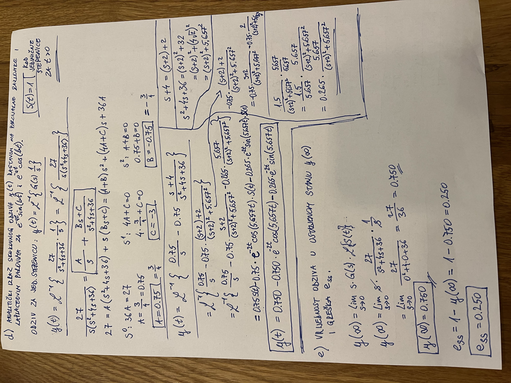
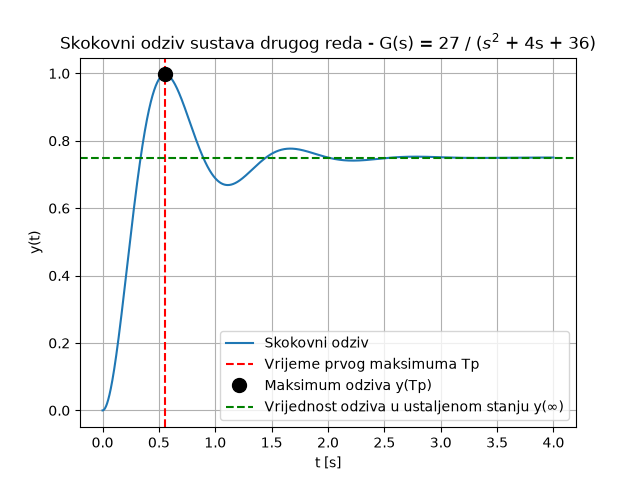

# Skokovni odziv

## Zadaci a, b i c

## Zadaci d i e

## Zadatak f

Zadatak f je napravljen unutar ove mape.

Slika skokovnog odziva izrađena pomoću Python koda:

## Osvrt na izračun

Vrijednosti očitane iz simulacije (signal.step) kod prvog pokretanja nisu se u potpunosti podudarale s izračunatim vrijednostima u zadatku.

Također, neke vrijednosti u zadatku odstupale su od ispravnih vrijednosti radi zaokruživanja (npr. postotak nadvišenja P.O.).
To je potaknulo ponovni ručni izračun i provjeru vrijednosti.

Kada se postotak nadvišenja ne zaokružuje, dobiju se sve ispravne vrijednosti i kod izračuna i kod simulacije.

Nakon prilagodbi zadanih postavki `signal.step()` funkcije, vrijednosti se podudaraju s analitički izračunatima na tri decimale, čime je potvrđena ispravnost izračuna iz točaka c i e.

| veličina | izračunato          | simulirano |
| -------- | ------------------- | ---------- |
| Tp [s]   | 0.555               | 0.555      |
| y_max    | nije računano ručno | 0.997      |
| y(∞)     | 0.750               | 0.750      |
