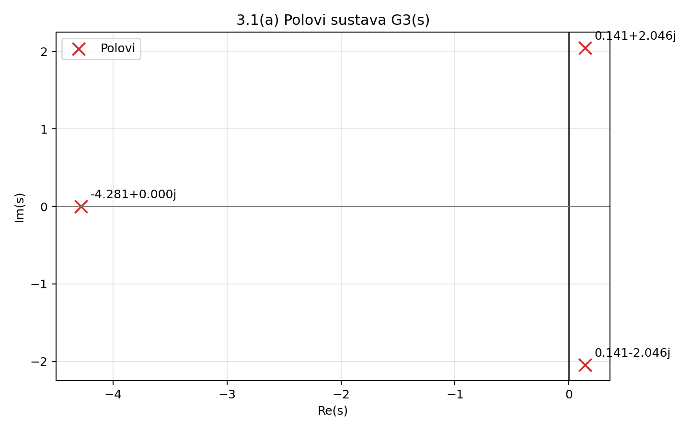
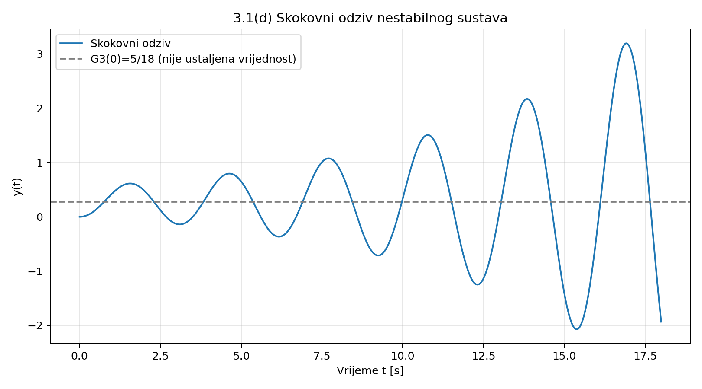
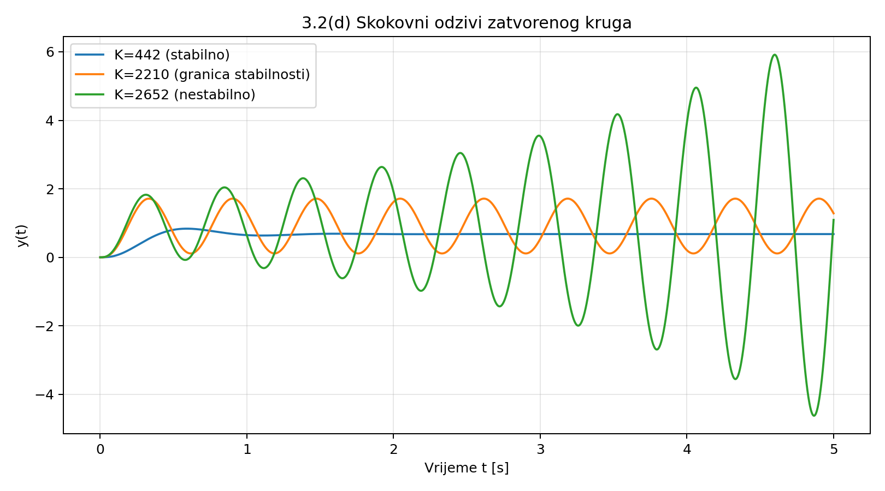

# Internet stvari – Prvi programski zadatak

## Zadatak 3 – Stabilnost sustava

**Grupa 10**

## 3.1 Položaj polova i Hurwitzov postupak

Zadano: G3(s) = (s + 5)/(s³ + 4s² + 3s + 18). Karakteristični polinom je P(s) = s³ + 4s² + 3s + 18.

a) Polovi sustava izračunati funkcijom numpy.roots([1, 4, 3, 18]) iznose s1 = −4,281; s2 = 0,141 + j2,046; s3 = 0,141 − j2,046. Dva pola imaju pozitivan realni dio, stoga je sustav nestabilan.

b) Nužni uvjet Hurwitzova kriterija je zadovoljen jer su svi koeficijenti karakterističnog polinoma pozitivni. Hurwitzova matrica:

H3 = [[4, 18, 0], [1, 3, 0], [0, 4, 18]].

D1 = 4,000; D2 = 4 · 3 − 18 = −6,000; D3 = 18 · (−6) = −108,000.

Budući da nisu sve vodeće poddeterminante pozitivne, sustav nije stabilan.

c) Obje metode daju isti zaključak: sustav je nestabilan. Pozitivnost koeficijenata samo je nužan, ne i dovoljan uvjet stabilnosti; D2 < 0.

d) Skokovni odziv ima oscilacije rastuće amplitude jer konjugirano-kompleksni polovi imaju pozitivan realni dio. Vrijednost G3(0) = 5/18 = 0,278 nije ustaljena vrijednost, jer odziv ne konvergira.

## 3.2 Interval pojačanja zatvorenog kruga

Zadano: G0(s) = K/[(s + 3)(s + 7)(s + 10)], jedinična negativna povratna veza i Kt = 442.

a) Gz(s) = G0(s)/(1 + G0(s)) = K/[(s + 3)(s + 7)(s + 10) + K].

(s + 3)(s + 7)(s + 10) = s³ + 20s² + 121s + 210.

Prema tome: Gz(s) = K/(s³ + 20s² + 121s + 210 + K).

b) Za P(s) = s³ + 20s² + 121s + (210 + K) Hurwitzova matrica je:

H3 = [[20, 210 + K, 0], [1, 121, 0], [0, 20, 210 + K]].

D1 = 20; D2 = 20 · 121 − (210 + K) = 2210 − K; D3 = (210 + K)(2210 − K).

Uvjeti stabilnosti su 210 + K > 0 i 2210 − K > 0. Dakle, −210 < K < 2210. Za pozitivno pojačanje regulatora: 0 < K < 2210.

c) Na granici stabilnosti D2 = 0, odnosno Kkr = 2210,000. Za K = Kkr nazivnik je s³ + 20s² + 121s + 2420 = (s + 20)(s² + 121).

Uvrštavanjem s = jω dobiva se (2420 − 20ω²) + j(121ω − ω³) = 0. Za ω > 0 vrijedi ω² = 121, pa je ωkr = 11,000 rad/s. Polovi su −20 i ±j11.

d) Za K = Kt = 442 polovi su −14,801 i −2,599 ± j6,107: odziv se smiruje (stabilan sustav). Za K = Kkr = 2210 polovi su −20 i ±j11: trajne oscilacije (granica stabilnosti). Za K = 1,2Kkr = 2652 polovi su −20,798 i 0,399 ± j11,724: oscilacije rastu (nestabilan sustav).

## Zaključak

U zadatku 3.1 položaj polova i Hurwitzove poddeterminante potvrđuju nestabilnost sustava. U zadatku 3.2 zatvoreni krug stabilan je za −210 < K < 2210, a na kritičnom pojačanju Kkr = 2210 pojavljuju se trajne oscilacije frekvencije 11 rad/s.

## Prilog – Python kod

Potrebne biblioteke: numpy, scipy i matplotlib. Pokretanje: python zadatak3.py.

**Slika: 3_1_polovi.png**



**Slika: 3_1_skokovni_odziv.png**



**Slika: 3_2_tri_odziva.png**



### Potpuni ispis Python koda

```python

"""
Pokretanje: python stabilnost_sustava.py
Potrebno: numpy, scipy, matplotlib
Grafovi se spremaju uz ovu skriptu.
"""
from pathlib import Path
import numpy as np
import matplotlib.pyplot as plt
from scipy import signal

MAPA = Path(__file__).resolve().parent

# ---------------------------------------------------------------
# 3.1(a) Polovi sustava i procjena stabilnosti
# Polovi su nultočke nazivnika prijenosne funkcije G3(s).
# Sustav je asimptotski stabilan samo ako svi polovi imaju Re(s) < 0.
# ---------------------------------------------------------------
brojnik_3 = [1, 5]
nazivnik_3 = [1, 4, 3, 18]
polovi_3 = np.roots(nazivnik_3)
stabilan_3 = np.all(polovi_3.real < 0)
print('3.1(a) Polovi:', np.round(polovi_3, 3))
print('3.1(a) Asimptotski stabilan:', stabilan_3)

fig, ax = plt.subplots(figsize=(8, 5))
ax.scatter(polovi_3.real, polovi_3.imag, marker='x', s=110,
           color='tab:red', label='Polovi')
ax.axvline(0, color='black', linewidth=1)
ax.axhline(0, color='gray', linewidth=0.8)
for pol in polovi_3:
    ax.annotate(f'{pol.real:.3f}{pol.imag:+.3f}j',
                (pol.real, pol.imag), xytext=(8, 7),
                textcoords='offset points')
ax.set(xlabel='Re(s)', ylabel='Im(s)',
       title='3.1(a) Polovi sustava G3(s)')
ax.grid(alpha=0.3)
ax.legend()
fig.tight_layout()
fig.savefig(MAPA / '3_1_polovi.png', dpi=180)
plt.close(fig)

# ---------------------------------------------------------------
# 3.1(b) Hurwitzov kriterij za kubni polinom
# Nužan uvjet: pozitivni koeficijenti. Dovoljan uvjet za
# asimptotsku stabilnost: sve vodeće poddeterminante > 0.
# ---------------------------------------------------------------
b2, b1, b0 = 4, 3, 18
H3 = np.array([[b2, b0, 0],
               [1, b1, 0],
               [0, b2, b0]], dtype=float)
D1 = b2
D2 = b2 * b1 - b0
D3 = b0 * D2
print('3.1(b) Hurwitzova matrica:\n', H3)
print(f'3.1(b) D1={D1:.3f}, D2={D2:.3f}, D3={D3:.3f}')
# 3.1(c): oba postupka pokazuju nestabilnost.
print('3.1(c) Zaključak: nestabilan sustav (D2 i D3 < 0).')

# ---------------------------------------------------------------
# 3.1(d) Skokovni odziv nestabilnog sustava
# Konjugirani polovi s pozitivnim realnim dijelom daju
# oscilacije rastuće amplitude. G3(0) nije konačni odziv.
# ---------------------------------------------------------------
t_31 = np.linspace(0, 18, 2000)
_, odziv_31 = signal.step(
    signal.TransferFunction(brojnik_3, nazivnik_3), T=t_31)
fig, ax = plt.subplots(figsize=(9, 5))
ax.plot(t_31, odziv_31, label='Skokovni odziv')
ax.axhline(5 / 18, color='gray', linestyle='--',
           label='G3(0)=5/18 (nije ustaljena vrijednost)')
ax.set(xlabel='Vrijeme t [s]', ylabel='y(t)',
       title='3.1(d) Skokovni odziv nestabilnog sustava')
ax.grid(alpha=0.3)
ax.legend()
fig.tight_layout()
fig.savefig(MAPA / '3_1_skokovni_odziv.png', dpi=180)
plt.close(fig)

# ---------------------------------------------------------------
# 3.2(a) Jedinična negativna povratna veza:
# Gz(s) = K / [(s+3)(s+7)(s+10) + K].
# 3.2(b) Hurwitz: D2 = 20*121 - (210+K) > 0;
# D3 = (210+K)*D2 > 0. Dakle -210 < K < 2210.
# ---------------------------------------------------------------
p1, p2, p3 = 3, 7, 10
nazivnik_otvorenog = np.poly([-p1, -p2, -p3])
a2, a1, a0 = nazivnik_otvorenog[1:]
K_t = 442
K_kr = a2 * a1 - a0
omega_kr = np.sqrt(a1)
print('3.2(a) Otvoreni nazivnik:', nazivnik_otvorenog)
print(f'3.2(b) Interval stabilnosti: {-a0:.3f} < K < {K_kr:.3f}')

# 3.2(c) Za K=Kkr nazivnik se faktorizira na
# (s+20)(s^2+121), pa su trajne oscilacije na omega=11 rad/s.
print(f'3.2(c) Kkr={K_kr:.3f}, omega_kr={omega_kr:.3f} rad/s')

# ---------------------------------------------------------------
# 3.2(d) Usporedba triju odziva:
# Kt: svi polovi lijevo -> smirivanje.
# Kkr: polovi na imaginarnoj osi -> trajne oscilacije.
# 1.2*Kkr: polovi desno -> rastuće oscilacije.
# ---------------------------------------------------------------
t_32 = np.linspace(0, 5, 3000)
slucajevi = [(K_t, 'K=442 (stabilno)'),
            (K_kr, 'K=2210 (granica stabilnosti)'),
            (1.2 * K_kr, 'K=2652 (nestabilno)')]
fig, ax = plt.subplots(figsize=(9, 5))
for K, oznaka in slucajevi:
    nazivnik_zatvorenog = nazivnik_otvorenog.copy()
    nazivnik_zatvorenog[-1] += K
    sustav = signal.TransferFunction([K], nazivnik_zatvorenog)
    _, y = signal.step(sustav, T=t_32)
    ax.plot(t_32, y, label=oznaka)
    print(f'3.2(d) {oznaka}, polovi:',
          np.round(np.roots(nazivnik_zatvorenog), 3))
ax.set(xlabel='Vrijeme t [s]', ylabel='y(t)',
       title='3.2(d) Skokovni odzivi zatvorenog kruga')
ax.grid(alpha=0.3)
ax.legend()
fig.tight_layout()
fig.savefig(MAPA / '3_2_tri_odziva.png', dpi=180)
plt.close(fig)
print('Grafovi su spremljeni u:', MAPA)
```
